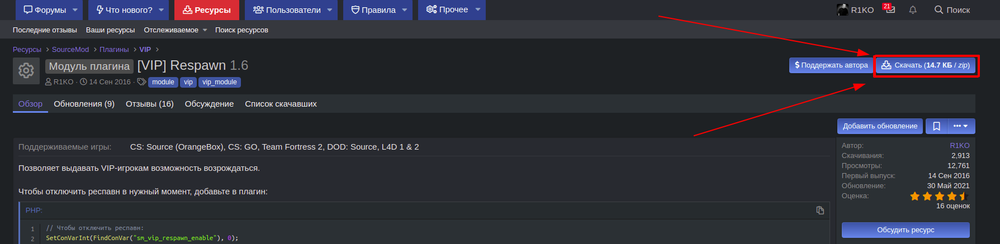
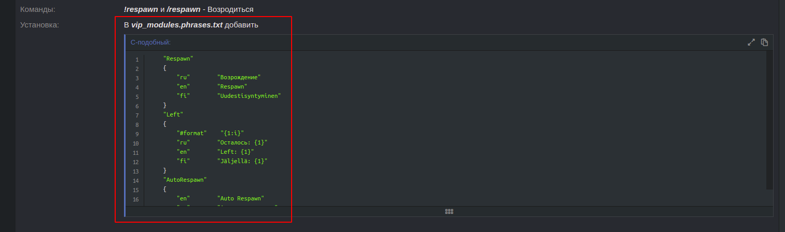
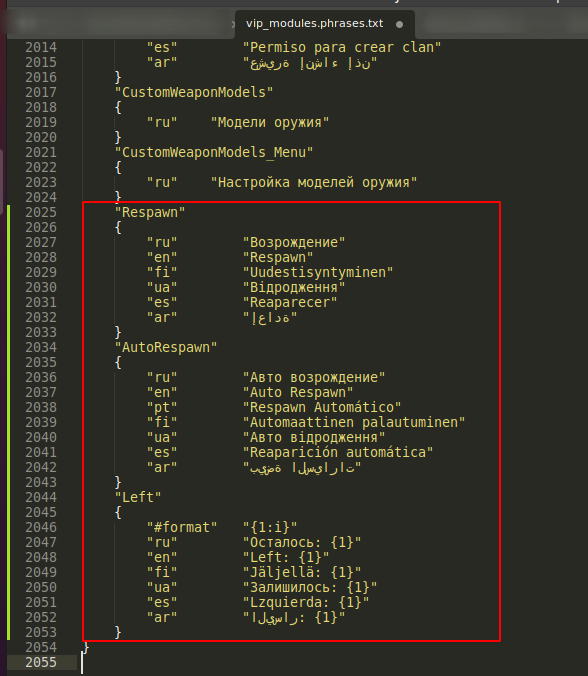
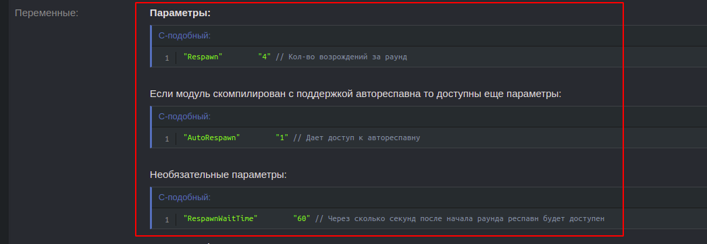
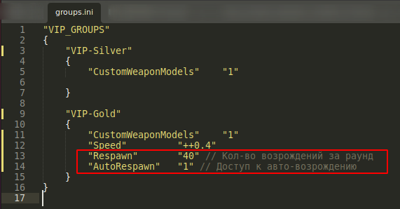

# Installing and configuring modules

[<- Back to contents](../index.md)

> Save every file as UTF-8 without BOM, e.g. with [Notepad++](https://notepad-plus-plus.org/downloads/)

1. Download the module archive.
2. Unpack it and copy the files into the matching folders on the server.
3. Add the module's phrases to the modules translation file `addons/sourcemod/translations/vip_modules.phrases.txt` (see the module's description; skip if it has none).
4. Configure the module's config in `addons/sourcemod/data/vip/modules/` (see the module's description; skip if it has none).
5. Add the module's parameters to the VIP groups that should have it, in `addons/sourcemod/data/vip/cfg/groups.ini` (see the module's description). Groups can also [inherit parameters](Install-Core.md#group-inheritance-extend) from other groups.
6. After the first start the module may create a config in `cfg/vip/` (see the module's description; skip if it has none).

## Example

Let's install [[VIP] Respawn](https://hlmod.net/resources/vip-respawn.221/) step by step:

1. Download the module files: 
2. Unpack the archive and copy the files into the matching folders on the server.
3. Add the module's phrases to `addons/sourcemod/translations/vip_modules.phrases.txt`:   
4. Module config - *skip, the module doesn't mention one*.
5. Add the parameters to the VIP groups:   
6. Config created after start - *skip, the module doesn't mention one*.
7. Restart the server or change the map (run **sm_reload_translations** if you changed a translation file) and enjoy.
